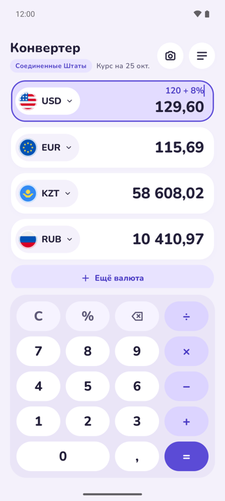
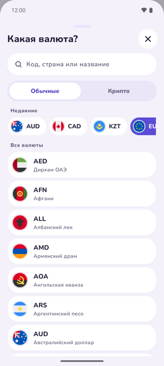
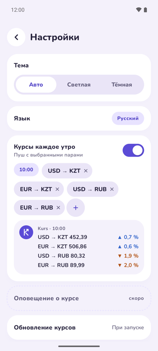
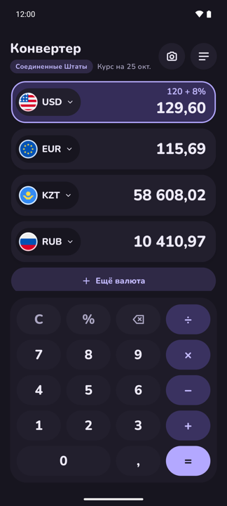

# Kurs

Минималистичный конвертер валют для Android. Несколько валют на одном экране, своя клавиатура-калькулятор и курсы, которые работают без интернета.

<p>
  
  
  
  
</p>

## Установка

1. Открой последний [релиз](https://github.com/shpuljka/kurs/releases/latest) с телефона и скачай файл `Kurs-v….apk`.
2. Открой скачанный файл. Android спросит разрешение устанавливать приложения из этого источника (браузера или «Файлов»): разреши и вернись к установке.
3. Новые версии ставятся так же, поверх старой, настройки сохраняются.

Нужен Android 10 или новее.

## Что умеет

- **От 2 до 10 валют сразу.** Вводишь сумму в любой строке, остальные пересчитываются. Строку можно смахнуть влево, чтобы удалить.
- **Калькулятор прямо в поле.** `120 + 8%` прибавит налог, `×` и `÷` тоже работают. Курсор можно поставить в любое место и поправить сумму.
- **Валюта страны, где ты сейчас.** Kurs определяет страну по сотовой сети, SIM-карте или региону в настройках телефона и ставит её валюту первой строкой. В поездке строка меняется сама.
- **Курсы офлайн.** При запуске приложение обновляет курсы, а без сети показывает последние сохранённые и дату, на которую они актуальны.
- **Утренняя сводка.** По желанию раз в день приходит уведомление с выбранными парами валют и изменением за сутки.
- **Светлая и тёмная тема, 12 языков интерфейса:** русский, английский, испанский, португальский, немецкий, французский, итальянский, турецкий, китайский, японский, корейский и хинди.

## Сборка

Понадобятся JDK 21 и Android SDK, проще всего поставить Android Studio.

```sh
./gradlew assembleDebug        # APK в app/build/outputs/apk/debug/
./gradlew testDebugUnitTest    # юнит-тесты
```

Или открыть папку проекта в Android Studio и нажать Run. Приложение работает на Android 10 и новее.

## Релизы

Новая версия выпускается тегом: `git tag v0.2.0 && git push origin v0.2.0`. GitHub Actions прогонит тесты, соберёт подписанный APK и выложит его в [Releases](https://github.com/shpuljka/kurs/releases).

## Устройство

Kotlin, Jetpack Compose, Material 3. Курсы хранятся в DataStore, сводку по расписанию отправляет WorkManager, суммы считаются в `BigDecimal`, поэтому без ошибок округления.

| Папка | Что внутри |
|---|---|
| `calc/` | калькулятор выражений и форматирование сумм под язык |
| `converter/` | главный экран: строки валют, клавиатура |
| `picker/` | выбор валюты |
| `data/` | курсы, справочник валют, определение страны, настройки |
| `digest/` | утренняя сводка курсов |
| `settings/` | экран настроек |

Все решения по продукту и дизайну описаны в [`spec.md`](spec.md).

## Откуда курсы

- Основной источник: [fawazahmed0/exchange-api](https://github.com/fawazahmed0/exchange-api), бесплатный и без ключа.
- Запасной: [open.er-api.com](https://open.er-api.com).

## Благодарности

- Флаги: [circle-flags](https://github.com/HatScripts/circle-flags) от HatScripts, лицензия MIT.
- Шрифт: [Nunito](https://fonts.google.com/specimen/Nunito), лицензия SIL Open Font License.

Тексты лицензий лежат в [`licenses/`](licenses).
